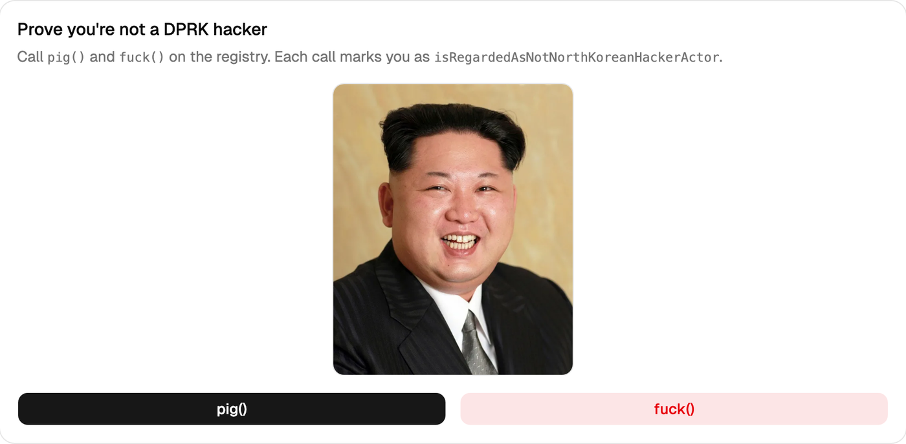

# KimJongUn Foundry Contract

This repo contains:

- `KimJongUn`: a registry contract that records which addresses have called `pig()` and `fuck()`
- `KimJongUnEligibilityHook`: an example Uniswap v4 gate hook that only allows trading and LP actions for addresses that have done both
- `src/launchpad/`: **DPRK.FUN launchpad for BNB Chain**. A soulbound *Not-Lazarus Pass* ("김정은 개새끼" pass) that you can only claim after `pig()` + `fuck()`, plus a pass-gated bonding-curve launchpad that graduates to PancakeSwap V2. See [`docs/BSC_LAUNCHPAD.md`](./docs/BSC_LAUNCHPAD.md). Unaudited.
- `frontend/`: **DPRK.FUN: Lazarus Checker** — a Vite + React + wagmi/viem dapp that lets users call `pig()` / `fuck()` and watch the global stats. Global counters are served from a Netlify Function (`/api/stats`) cached on the durable edge for 15s, so every visitor shares one RPC hit. Live at [dprk.fun](https://dprk.fun). See [`frontend/README.md`](./frontend/README.md).

[](https://dprk.fun)

<sub>The click surface: press `pig()` or `fuck()` to sign a transaction that stamps you as `isRegardedAsNotNorthKoreanHackerActor` on the registry.</sub>

## Contract behavior

When an address calls either:

- `pig()`
- `fuck()`

the contract records that caller as `isRegardedAsNotNorthKoreanHackerActor == true`.

It also tracks:

- per-address `pig()` call counts
- per-address `fuck()` call counts
- total unique verified addresses
- total `pig()` calls
- total `fuck()` calls

Useful checker functions:

- `hasPiggedKimJongUn(address)`
- `hasFuckedKimJongUn(address)`
- `hasPiggedOrFuckedKimJongUn(address)`
- `hasPiggedAndFuckedKimJongUn(address)`

The strict checker for integrations is:

- `hasPiggedAndFuckedKimJongUn(address)`

## Build

```sh
forge build
```

## Test

```sh
forge test
```

## Optimized compile profile

The repo is configured to compile for maximum runtime optimization in `foundry.toml`:

```toml
optimizer = true
optimizer_runs = 44444444
via_ir = true
gas_reports = ["KimJongUn", "KimJongUnEligibilityHook"]
```

To rebuild and print the gas report under this profile:

```sh
forge test --gas-report
```

## Gas table

Numbers below are from `forge test --gas-report` with the optimized profile above.

### `KimJongUn` contract

| Action | Gas |
| --- | ---: |
| Deploy `KimJongUn` | 414,889 |
| `pig()` | 111,893 |
| `fuck()` avg | 73,747 |
| `fuck()` first-write max | 111,916 |
| `fuck()` repeat-call min | 35,375 |
| `hasPiggedKimJongUn(address)` | 2,602 |
| `hasFuckedKimJongUn(address)` | 2,536 |
| `hasPiggedOrFuckedKimJongUn(address)` | 2,558 |
| `hasPiggedAndFuckedKimJongUn(address)` avg | 4,136 |
| `isRegardedAsNotNorthKoreanHackerActor(address)` | 2,448 |
| `pigCalls(address)` | 2,371 |
| `fuckCalls(address)` | 2,481 |
| `totalPigCalls()` | 2,245 |
| `totalFuckCalls()` | 2,492 |
| `totalVerifiedAddresses()` | 2,429 |

### Hook-gated actions

These numbers are end-to-end test scenario costs for the example Uniswap v4 hook flow, not isolated callback-only gas:

| Action | Gas |
| --- | ---: |
| Reject unqualified swap / LP path | 107,432 |
| Allow qualified direct pool-manager caller | 348,498 |
| Allow trusted forwarder with `hookData = abi.encode(user)` | 330,200 |
| Reject malformed `hookData` | 72,758 |
| Reject spoofed user from untrusted forwarder | 261,434 |

## DPRK.FUN launchpad (BNB Chain)

The contracts live in `src/launchpad/`, and the spec plus implementation notes are in
[`docs/BSC_LAUNCHPAD.md`](./docs/BSC_LAUNCHPAD.md).

| Contract | Role |
| --- | --- |
| `DprkPass` | Soulbound ERC-721 + ERC-5192. `claim()` requires `hasPiggedAndFuckedKimJongUn(msg.sender)`, and `tokenURI` is an on-chain SVG. |
| `DprkLaunchpad` | Pass-gated `createToken`/`buy`. `sell` is always open. Virtual constant-product curves, graduating inline to PancakeSwap V2 with the LP burned. |
| `DprkToken` | Fixed-supply ERC-20. Before graduation, only the launchpad and pass holders can receive it. |

```sh
forge test --match-path 'test/launchpad/*'                       # unit, fuzz, invariant (fork test skips)
BSC_RPC_URL=https://bsc-dataseed.bnbchain.org \
  forge test --match-path 'test/launchpad/*Fork*' -vv            # real PancakeSwap V2 + WBNB on a mainnet fork
FOUNDRY_PROFILE=deep forge test --match-path 'test/launchpad/*'  # long fuzz/invariant campaign

anvil   # or: anvil --fork-url https://bsc-dataseed.bnbchain.org
forge script script/DeployDprkFun.s.sol --rpc-url http://127.0.0.1:8545 --broadcast --private-key <anvil key #0>
node script/export-abis.mjs                                      # frontend/src/lib/abi/launchpad.ts
```

`DeployDprkFun` uses the real PancakeSwap V2 factory and WBNB on chains 56 and 97, and deploys mocks on any other
chain. It writes `deployments/<chainId>.json` and prints the `VITE_*` lines for `frontend/.env.local`.

## Deploy

Deploy the base registry:

```sh
forge script script/KimJongUn.s.sol:KimJongUnScript \
  --rpc-url <your_rpc_url> \
  --private-key <your_private_key> \
  --broadcast
```

## Trigger `pig()` and `fuck()` on chain

Replace `KIM_JONG_UN_ADDRESS` with your deployed contract address.

### With `cast`

Call `pig()`:

```sh
cast send KIM_JONG_UN_ADDRESS "pig()" \
  --rpc-url <your_rpc_url> \
  --private-key <your_private_key>
```

Call `fuck()`:

```sh
cast send KIM_JONG_UN_ADDRESS "fuck()" \
  --rpc-url <your_rpc_url> \
  --private-key <your_private_key>
```

Read the strict checker:

```sh
cast call KIM_JONG_UN_ADDRESS \
  "hasPiggedAndFuckedKimJongUn(address)(bool)" \
  0xYourUserAddress \
  --rpc-url <your_rpc_url>
```

Read the individual checkers:

```sh
cast call KIM_JONG_UN_ADDRESS \
  "hasPiggedKimJongUn(address)(bool)" \
  0xYourUserAddress \
  --rpc-url <your_rpc_url>

cast call KIM_JONG_UN_ADDRESS \
  "hasFuckedKimJongUn(address)(bool)" \
  0xYourUserAddress \
  --rpc-url <your_rpc_url>
```

### From Solidity

```solidity
interface IKimJongUn {
    function pig() external;
    function fuck() external;
    function hasPiggedKimJongUn(address account) external view returns (bool);
    function hasFuckedKimJongUn(address account) external view returns (bool);
    function hasPiggedOrFuckedKimJongUn(address account) external view returns (bool);
    function hasPiggedAndFuckedKimJongUn(address account) external view returns (bool);
}
```

Example usage:

```solidity
IKimJongUn verifier = IKimJongUn(0xYourKimJongUnAddress);

function triggerBoth() external {
    verifier.pig();
    verifier.fuck();
}

function isStrictlyVerified(address user) external view returns (bool) {
    return verifier.hasPiggedAndFuckedKimJongUn(user);
}
```

## Uniswap v4 hook example

The example hook is at `src/hooks/KimJongUnEligibilityHook.sol`.

It restricts:

- swaps
- add liquidity
- remove liquidity

to addresses that satisfy:

```solidity
VERIFIER.hasPiggedAndFuckedKimJongUn(user)
```

### Hook constructor

The hook constructor is:

```solidity
constructor(
    IPoolManager poolManager_,
    KimJongUn verifier_,
    address trustedForwarder_
)
```

Arguments:

- `poolManager_`: the Uniswap v4 `PoolManager`
- `verifier_`: deployed `KimJongUn` contract
- `trustedForwarder_`: trusted router or position manager allowed to pass the real end user in `hookData`

### Direct caller flow

If the user interacts directly through the `PoolManager` caller path, the hook checks:

```solidity
sender
```

### Forwarded caller flow

If your router or position manager is the configured `TRUSTED_FORWARDER`, pass:

```solidity
bytes memory hookData = abi.encode(user);
```

The hook will then verify that user instead of the router address.

This prevents arbitrary routers from spoofing verified users.

### Example forwarder pattern

```solidity
bytes memory hookData = abi.encode(msg.sender);

poolManager.swap(key, params, hookData);
```

For LP actions:

```solidity
bytes memory hookData = abi.encode(msg.sender);

poolManager.modifyLiquidity(key, liquidityParams, hookData);
```

### Encoding `hookData` with `cast`

If you need ABI-encoded user data off-chain:

```sh
cast abi-encode "f(address)" 0xYourUserAddress
```

That returns the raw bytes payload you can pass as `hookData`.

### Important deployment note

This hook is a real example contract, but Uniswap v4 hooks cannot be deployed to arbitrary addresses.
The deployed hook address must have low permission bits matching the enabled callbacks:

- `BEFORE_SWAP_FLAG`
- `BEFORE_ADD_LIQUIDITY_FLAG`
- `BEFORE_REMOVE_LIQUIDITY_FLAG`

So in production you need a deployment flow that lands the hook bytecode at an address with the required hook flags.
